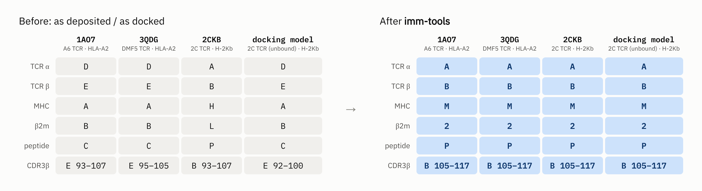

<p align="center">
  <picture>
    <source media="(prefers-color-scheme: dark)" srcset="docs/images/logo-lockup-dark.png">
    
  </picture>
</p>

Consistent IMGT numbering and chain IDs for TCR–pMHC structures (TCR, MHC of any species,
β2m, peptide), so that the same residue number means the same place in every structure.

Command-line tools in the style of [pdb-tools](https://github.com/haddocking/pdb-tools)
(PDB or mmCIF in, stdout out, chainable with pipes), plus a Python interface.

[](https://colab.research.google.com/github/X-lab-3D/imm-tools/blob/main/examples/try_imm_tools.ipynb) – try every tool in your browser, nothing to install.

## What is it for?

Every PDB entry, and every docking or prediction model, names its chains and numbers its
residues its own way. Chain A is the MHC in one file and the TCR α chain in the next; the
same CDR3β loop of the same TCR is 93–107 in one file and 92–100 in another. imm-tools gives
all of them one layout:



*Before: chain IDs and CDR3β residue numbers as deposited (1AO7, 3QDG, 2CKB) or as written
by a docking program (unbound 2C TCR from 1TCR placed on 2CKB, residues numbered from 1).
After: the same files after `imm_complex -1 | imm_rechain | imm_tcrnum | imm_mhcnum | imm_pepnum`.*

That makes everyday tasks one-liners instead of per-structure scripts:

* **Evaluate docking and prediction models.** Models are built from unbound structures and
  do not match the bound reference's chains or numbering. Standardise both, and residues
  pair up by chain and number, so L-RMSD, I-RMSD, fnat and DockQ need no alignment step –
  even when the two differ in missing residues or where the numbering starts
  ([examples/docking_rmsd.py](examples/docking_rmsd.py)).
* **Select the same region in any structure.** `select cdr3b, chain B and resi 105-117` in
  PyMOL works on every complex; so do the groove helices (`chain M and resi 50-92`)
  ([examples/pymol_regions.py](examples/pymol_regions.py)).
* **Compare and pool many structures.** Contacts, conformations or features by IMGT
  position across complexes, alleles and species
  ([examples/contact_map.py](examples/contact_map.py)).
* **Prepare datasets** (e.g. for machine learning): one complex per file, the same chain
  order and numbering, a table of chain types, genes and alleles
  ([examples/batch.sh](examples/batch.sh)).

## What it covers

| tool | what it does |
|---|---|
| `imm_annotate` | each chain's type, complex, species, closest gene / allele and domain ranges (TSV) |
| `imm_seq` | chain sequences (FASTA) with their type |
| `imm_complex` | pick one TCR–pMHC complex out of a multi-copy file |
| `imm_rechain` | rename chains to the standard layout (A, B, M, N, 2, P), configurable |
| `imm_tcrnum` | IMGT-number the TCR (V domain; `-const` also the constant domain) |
| `imm_mhcnum` | IMGT-number the MHC chains and β2m (G and C-like domains, fixed domain offsets), any species |
| `imm_pepnum` | number the peptide 1…n |
| `imm_split` | write TCR, pMHC, MHC and peptide as separate files |
| `imm_cdr` | print or select the CDRs |
| `imm_check` | sanity-check the numbering (conserved Cys/Trp/Phe anchors, MHC numbering confidence, chain breaks) |
| `imm_setup` | check that the ANARCI backend used for TCR chains works |

Chains recognised: TCR α / β / γ / δ, MHC class I heavy chain, MHC class II α / β, β2m,
peptide (a protein chain of ≤ 30 residues without a domain), and antibody heavy / κ / λ.
All except antibodies are numbered. Antibody chains are recognised (`imm_seq`,
`imm_annotate`) but not yet numbered or paired; the tools are built so that this can be
added – contributions welcome; [CONTRIBUTING.md](CONTRIBUTING.md) explains how, with a
step-by-step guide for antibodies.

### imm-tools, ANARCI and ANARCII

[ANARCI](https://github.com/oxpig/ANARCI) and its successor
[ANARCII](https://github.com/oxpig/ANARCII) number antibody and TCR **variable domains**:
given a sequence, they tell you which residue is IMGT position 27, 104, … imm-tools uses
ANARCI for exactly that step. What imm-tools adds is everything else needed to make
TCR–pMHC **structure files** consistent:

| | ANARCI / ANARCII | imm-tools |
|---|---|---|
| works on | sequences (ANARCII can also read them from structure files) | PDB and mmCIF files, written back renumbered with everything else kept (sequences too, in Python) |
| TCR variable domain | ✓ | ✓ (via ANARCI) |
| TCR constant domain | – | ✓ |
| MHC class I and II, β2m, any species | – | ✓ |
| peptide | – | numbered 1…n |
| antibodies | ✓ | recognised, not numbered yet |
| finds complexes, standard chain IDs, splits, checks | – | ✓ |

In short: to number receptor sequences (e.g. from repertoire sequencing), use ANARCI or
ANARCII; to make TCR–pMHC structures comparable, use imm-tools.

## Install

```bash
pip install git+https://github.com/X-lab-3D/imm-tools.git
```

or from a clone:

```bash
git clone https://github.com/X-lab-3D/imm-tools.git
cd imm-tools
pip install -e .
```

This installs everything, including pdb-tools and ANARCI. If pip refuses with
"externally-managed-environment" (e.g. Homebrew Python), install into a conda or virtual
environment, or use `pipx install --include-deps git+https://github.com/X-lab-3D/imm-tools.git`.

Or try it first in Google Colab, without installing anything: [open the notebook](https://colab.research.google.com/github/X-lab-3D/imm-tools/blob/main/examples/try_imm_tools.ipynb).

## A quick tour

Each tool does one thing. Get a structure (3QDG: the DMF5 TCR bound to HLA-A2 with a
MART-1 peptide) and try them one by one:

```bash
curl -o 3qdg.pdb https://files.rcsb.org/download/3QDG.pdb
```

**What is in the file?**

```bash
imm_annotate 3qdg.pdb
```
```
chain  type       complex  length  species       gene_allele                                  identity      domains
A      MHC_I      1        275     Homo sapiens  HLA-A*02:01 / HLA-A*02:09 / ...              100.0         G_ALPHA1:1-90;G_ALPHA2:91-182;C_ALPHA3:183-275
B      B2M        1        100     Homo sapiens  Beta-2-microglobulin [UniProt P61769] / ...  99.0          C_B2M:1-99
C      peptide    1        10
D      TCR_alpha  1        199     Homo sapiens  TRAV12-2*01 / TRAJ23*01                      97.8 / 100.0  V:1-109;C:110-199
E      TCR_beta   1        242     Homo sapiens  TRBV6-4*01 / TRBJ1-1*01                      98.9 / 100.0  V:4-115;C:116-245
```

(Shortened; the real output is tab-separated, starts with a `file` column and opens in any
spreadsheet.)

**Sequences**

```bash
imm_seq -tcr 3qdg.pdb > tcr.fasta        # >3qdg:D|TCR_alpha|human, 134 bits ...
```

**Standard chain IDs** – TCR α A, TCR β B, MHC M, β2m 2, peptide P:

```bash
imm_rechain 3qdg.pdb > 3qdg_std.pdb
```
```
tcra: D -> A
tcrb: E -> B
mhc: A -> M
b2m: B -> 2
pep: C -> P
```

**IMGT numbering** – of the TCR (`-const`: constant domains too), the MHC and β2m, and the
peptide (1…n). Each tool numbers its own chains and leaves the others alone:

```bash
imm_tcrnum 3qdg_std.pdb > 3qdg_tcr.pdb
imm_mhcnum 3qdg_tcr.pdb > 3qdg_tcr_mhc.pdb
imm_pepnum 3qdg_tcr_mhc.pdb > 3qdg_imgt.pdb
```
```
chain A: TCR_alpha (human, 134 bits)
chain B: TCR_beta (human, 140 bits)
chain M: MHC_I (G_ALPHA1 149 bits, G_ALPHA2 151 bits, C_ALPHA3 148 bits)
chain 2: B2M (C_B2M 154 bits)
chain P: peptide, 10 residues numbered 1-10
```

**CDRs** – a table, or the loops as a PDB file (`imm_cdr -cdr3 3qdg_imgt.pdb > cdr3.pdb`):

```bash
imm_cdr 3qdg_imgt.pdb
```
```
chain  type       cdr   residues  length  sequence
A      TCR_alpha  CDR1  27-38     6       DRGSQS
A      TCR_alpha  CDR2  56-65     6       IYSNGD
A      TCR_alpha  CDR3  105-117   10      AVNFGGGKLI
B      TCR_beta   CDR1  27-38     5       MRHNA
B      TCR_beta   CDR2  56-65     6       SNTAGT
B      TCR_beta   CDR3  105-117   11      ASSLSFGTEAF
```

**Check the numbering**

```bash
imm_check 3qdg_imgt.pdb
```
```
chain  type       check       status  detail
M      MHC_I      numbering   OK      275/275 residues as IMGT (100.0%)
M      MHC_I      anchors     OK      C1011 C1074 C2023 W2041 C2104
M      MHC_I      confidence  OK      lowest domain score C_ALPHA3 148 bits
A      TCR_alpha  anchors     OK      C23 W41 C104 F118
B      TCR_beta   breaks      OK      no chain breaks
```

**Split into parts**

```bash
imm_split 3qdg_imgt.pdb       # 3qdg_imgt_TCR.pdb, _pMHC.pdb, _MHC.pdb, _peptide.pdb
```

**Several complexes in one file?** Many entries hold two or more copies. List them and keep one:

```bash
imm_complex -1 2ckb.pdb > 2ckb_1.pdb
```
```
complex 1: tcra=A tcrb=B mhc=H b2m=L pep=P
complex 2: tcra=C tcrb=D mhc=I b2m=M pep=Q
```

## Putting it together

Every tool reads a file or the output of the previous one, so the steps above chain with
pipes into one line, with no intermediate files:

```bash
imm_complex -1 3qdg.pdb | imm_rechain | imm_tcrnum | imm_mhcnum | imm_pepnum > 3qdg_imgt.pdb
```

They mix with [pdb-tools](https://github.com/haddocking/pdb-tools) the same way, e.g.
`... | imm_pepnum | pdb_delhetatm > clean.pdb`. In Python it is one call:
`immtools.renumber(immtools.rechain("3qdg.pdb"), out="3qdg_imgt.pdb")`. For a whole folder,
a CDR3 table, contact maps, docking RMSDs and PyMOL colouring, see [examples/](examples/).

## Python

```python
import immtools

n = immtools.number_mhc("GSHSMRYFFTSVSRPGRGEPRFIAVGYVDDTQFVRFDSDAASQRMEPRAPWIEQEGPEY...")
n.chain_type                  # 'MHC_I'
n.labels[:3]                  # ['1', '2', '3']
n.domains                     # [('G_ALPHA1', 0, 88, 150.7), ('G_ALPHA2', 90, 175, 142.8), ...]
immtools.number_tcr(seq, constant=True)   # .genes: species, V / J genes

immtools.annotate("3qdg.pdb")              # list of dicts, as imm_annotate
immtools.complexes("1d9k.pdb")             # [{'mhc': 'C', 'mhcb': 'D', 'pep': 'P', ...}, ...]
immtools.cdrs("3qdg.pdb")                  # chain, cdr, residues, sequence
immtools.check("3qdg_imgt.pdb")            # list of dicts, as imm_check

text = immtools.renumber("3qdg.cif", out="3qdg_imgt.cif", constant=True)
text = immtools.rechain(immtools.select_complex("1d9k.pdb", 2), out="1d9k_2.pdb")

model = immtools.structure(text)           # Biopython model, for your own analyses
model["D"][104].get_resname()              # 'CYS': the conserved Cys at IMGT 104
```

Structures can be a file path (PDB or mmCIF), an open file or the file content as a
string; functions that change a structure return the new content and write it to `out` if
given. These functions (`help(immtools)`) are the stable interface; modules whose names start
with an underscore are internal.

## Reference

### Complexes and chain layout

`imm_complex`, `imm_rechain`, `imm_split` and `imm_annotate` group chains into complexes by
type and contacts (CA–CA ≤ 8 Å): MHC heavy chain (or class II α) → β2m (or class II β) → the
peptide touching the groove → the TCR α/β pair touching the pMHC. TCRs without pMHC and lone
MHC chains form complexes of their own.

Standard layout (`imm_rechain`): A TCR α (or γ), B TCR β (or δ), M MHC class I heavy chain /
class II α, N MHC class II β, 2 β2m, P peptide. β2m gets a digit so that H and L stay free for
antibody heavy and light chains, and because lower-case IDs are matched case-insensitively by
some viewers (PyMOL selections by default).

Prefer other chain IDs? Name them by role; the numbering is the same:

```bash
imm_rechain -mhc:A,b2m:B,pep:C,tcra:D,tcrb:E 1ao7.pdb > 1ao7_std.pdb
```

### Numbering

**TCR** (`imm_tcrnum`): IMGT numbering of the V domain by ANARCI. Without `-const`, residues after
the V domain continue after the highest IMGT number. With `-const`, the constant domain gets
IMGT C-LIKE numbering + 1000 (1001–1128; TRAC, TRBC, TRGC, TRDC; profile HMMs built from
IMGT/DomainDisplay, all species), residues after it 2001, 2002, …. Residues before the V
domain: 0, −1, … . A second V domain in the same chain (single-chain constructs) gets +1000.
Note: IMGT/3Dstructure-DB files number the TRAC constant domain 2001–2128; here every constant
domain is 1001–1128.

**MHC** (`imm_mhcnum`): IMGT unique numbering (G-DOMAIN 1–92, C-LIKE 1–128, IMGT insertion
codes such as 49A, 61A, 72A, 84A/85A) plus 1000 × the domain's place in the chain:

| chain | domain 1 | domain 2 | domain 3 |
|---|---|---|---|
| class I heavy chain | α1 1–92 | α2 1001–1092 | α3 2001–2128 |
| β2-microglobulin | 1–128 | | |
| class II α | α1 1–92 | α2 1001–1128 | |
| class II β | β1 1–92 | β2 1001–1128 | |

Residues before the first domain: 0, −1, …; after the last one: the next thousand. Chain
breaks are found from the coordinates, so missing loops do not shift the numbering.

MHC numbering uses two sets of profile HMMs with IMGT labels: a **broad** set covering all
jawed-vertebrate lineages (fish, amphibians, reptiles, birds, mammals) and a **mammal-focused**
set. Every domain is searched with both and numbered by the set that matches it best (higher
HMMER bit score); `imm_check` lists the residues the two sets number differently, which are
the least certain ones. The models (`immtools/models/mhc_broad`, `mhc_mammal`) were trained on
MHC sequences from IPD-IMGT/HLA, IPD-MHC and UniProt, with IMGT structures and AlphaFold DB
models as references; a description of the method will follow in a publication. The model
version is in `immtools/models/MODELS_VERSION.json`.


*`imm_mhcnum` on MHC class I of five species: the same IMGT position is the same place in the
structure (chicken and carp have an insertion, 54A; position 65 is residue 63–65 of the
sequences). Bars: how many of 10 TCR–pMHC complexes touch each position
([examples/contact_map.py](examples/contact_map.py)); 65, 66, 69, 72 and 73 are the classic
TCR contacts. Made with [docs/make_figures.py](docs/make_figures.py).*

**Peptide** (`imm_pepnum`): 1…n.

### Annotation

`imm_annotate` columns: file, chain, type, complex, length, species, gene_allele,
identity, domains.

* TCR: species and V / J germline genes from ANARCI, with the V and J identity.
* MHC: the closest allele / gene by the peptide-binding region (class I α1+α2, class II α1
  or β1; β2m: whole domain) among ~57,000 distinct regions from IPD-IMGT/HLA, IPD-MHC and
  UniProt, with % identity over that region. Alleles that share the region are listed
  together ("+N" more), so the 2-field allele is only resolved where the peptide-binding
  region differs.
* domains: `name:first-last` residue, in the numbering of the input file.

### Options

Each tool prints its help with `-h`. Options follow pdb-tools: one option, written
`-<value>`:

| tool | option |
|---|---|
| `imm_annotate`, `imm_mhcnum`, `imm_pepnum`, `imm_check` | `-A,B` chains (default: all) |
| `imm_seq` | `-tcr`, `-mhc`, `-pep` or chains |
| `imm_complex` | `-2` complex number (default 1); all complexes are listed on stderr |
| `imm_rechain` | your own chain IDs, e.g. `-mhc:A,b2m:B,pep:C,tcra:D,tcrb:E` (roles tcra, tcrb, mhc, mhcb, b2m, pep) |
| `imm_tcrnum` | `-const`, chains, or `-const:D,E` |
| `imm_split` | parts `-tcr,pmhc,mhc,pep` (default: all) |
| `imm_cdr` | none (table) or `-cdr1`, `-cdr3`, `-a3,b3`, … (PDB selection) |

### What the tools change in a file

The numbering tools change only the residue number and insertion code columns of ATOM /
HETATM / ANISOU / TER records, `imm_rechain` only the chain column; the residue references in
HELIX, SHEET, SSBOND, LINK and CISPEP records follow, so viewers such as PyMOL that read them
still show the right secondary structure. All other lines and columns are kept (SEQRES and
other header records are not updated). Waters and ligands keep their numbers unless they
collide with a new residue number (then they move after the chain's last residue). With
several models, the first model is analysed and the result applied to all. Files with bare
`TER` lines break some pdb-tools; `pdb_tidy` fixes them.

**PDB and mmCIF.** Every tool reads both (the format is recognised from the content) and
writes the same format as its input. mmCIF is needed for large entries (more than 99,999
atoms, or chain IDs longer than one character), which have no PDB-format file. In mmCIF
files the author fields change (`auth_asym_id`, `auth_seq_id`, `pdbx_PDB_ins_code`, and the
same fields in `struct_conf`, `struct_sheet_range`, `struct_conn`, `struct_mon_prot_cis`,
`pdbx_poly_seq_scheme`); `label_*` fields and all other categories are kept. The pdb-tools
commands (`pdb_*`) are PDB-only.

## How accurate is it? Please help test

Share of residues numbered as in the reference (IMGT/3Dstructure-DB unless noted):

| chains | test set | agreement |
|---|---|---|
| MHC class I | human and mouse structures¹ | 100 % |
| β2m | human and mouse structures¹ | 100 % |
| MHC class II α | human and mouse structures¹ | 99.96 % |
| MHC class II β | human and mouse structures¹ | 99.74 % |
| MHC, other species (chicken, macaque, pig, …) | structures, species held out | 98.5–100 % |
| MHC class I, grass carp | structures, species held out | 93.6 % |
| MHC, birds, reptiles, amphibians | AlphaFold models², lineage held out | 94–99 % |
| MHC class I / class II β, fish | AlphaFold models², lineage held out | 92.4 / 93.6 % |
| TCR constant domain, TRAC / TRBC | 143 distinct TCR chains, mostly human and mouse | 98.8 / 98.6 % |

¹ These structures are in the training data. ² No IMGT numbering exists for these; the
reference is the structurally equivalent position.

* Fish chains are the weakest; errors concentrate in loops and at domain ends. γδ constant
  domains are untested.
* Where IMGT numbers the same loop length differently in different species, one convention
  is used; where the structure clearly disagrees with an IMGT label, the structure wins. All
  such residues are listed in `immtools/models/mhc_broad/differences_from_imgt.tsv`.
* Not specifically tested: non-classical MHC (MR1, CD1, HFE, MIC, …), single-chain TCRs,
  peptides tethered to the MHC chain.

Please report structures where the output looks wrong (PDB ID, chain, residue), with the
stderr summary and the `imm_check` table.

## Tests

```bash
pip install pytest && pytest tests/        # unit tests + end-to-end tests of every tool
```

## Acknowledgements and third-party components

imm-tools builds on the following software and data. Please cite them when you use the
corresponding tools.

Software
* **ANARCI** – TCR (and antibody) V-domain numbering and chain-type / germline assignment
  (`imm_tcrnum`, `imm_cdr`, `imm_seq`, `imm_annotate`, `imm_check`). J. Dunbar and C. M. Deane,
  *Bioinformatics* 32, 298–300 (2016). © Oxford Protein Informatics Group, BSD-3-Clause.
  imm-tools uses the **pyhmmer port of ANARCI by David Prihoda**
  (https://github.com/prihoda/ANARCI), packaged with the IMGT HMMs as `anarci-pyhmmer` from
  the fork https://github.com/X-lab-3D/ANARCI-pyhmmer-fork. The fork includes MUSCLE (public
  domain), used only to rebuild the HMMs.
* **pyhmmer** – M. Larralde and G. Zeller, *Bioinformatics* 39, btad214 (2023); MIT. Python
  bindings to **HMMER** (S. R. Eddy, *PLoS Comput. Biol.* 7, e1002195 (2011)).
* **Biopython** – P. J. A. Cock et al., *Bioinformatics* 25, 1422–1423 (2009).
* **gemmi** – M. Wojdyr, *J. Open Source Softw.* 7, 4200 (2022); MPL-2.0. mmCIF reading and
  writing.
* **pdb-tools** – J. P. G. L. M. Rodrigues et al., *F1000Research* 7, 1961 (2018); the design
  of these tools follows pdb-tools.
* **TM-align** via **tmtools** – Y. Zhang and J. Skolnick, *Nucleic Acids Res.* 33, 2302–2309
  (2005); used only to build the MHC models, not at run time.

Data used to build the models and reference sequences
* **IMGT®**, the international ImMunoGeneTics information system® (https://www.imgt.org):
  IMGT/3Dstructure-DB and IMGT/DomainDisplay – IMGT unique numbering, MHC and TCR domain
  alignments. M.-P. Lefranc et al.; F. Ehrenmann, Q. Kaas and M.-P. Lefranc, *Nucleic Acids
  Res.* 38, D301–D307 (2010).
* **IPD-IMGT/HLA** (https://www.ebi.ac.uk/ipd/imgt/hla/) – J. Robinson et al.
* **IPD-MHC** (https://www.ebi.ac.uk/ipd/mhc/) – G. Maccari et al.
* **UniProt** (https://www.uniprot.org) – The UniProt Consortium; InterPro domain annotations.
* **AlphaFold Protein Structure Database** (https://alphafold.ebi.ac.uk) – M. Varadi et al.,
  *Nucleic Acids Res.* (2022, 2024); models under CC-BY-4.0.

IMGT data are used under the Creative Commons Attribution 4.0 (CC BY 4.0) licence. IMGT® is a
registered trademark of CNRS. imm-tools is not affiliated with or endorsed by IMGT, IPD,
UniProt or EMBL-EBI.

## Licence

The code is Apache-2.0 (see LICENSE and NOTICE). TCR V-domain numbering uses ANARCI
(BSD-3-Clause).

The MHC and TCR constant-domain models and the MHC reference sequences in `immtools/models`
are derived from data under these licences:

| data | licence |
|---|---|
| IMGT (IMGT/3Dstructure-DB, IMGT/DomainDisplay) | CC BY 4.0 |
| IPD-IMGT/HLA, IPD-MHC | CC BY-ND |
| UniProt | CC BY 4.0 |
| AlphaFold DB | CC BY 4.0 |

Please cite these resources (see Acknowledgements) and check their terms before
redistributing the models. The scripts that built the TCR constant-domain models and the MHC
reference sequences are in `dev/`.
