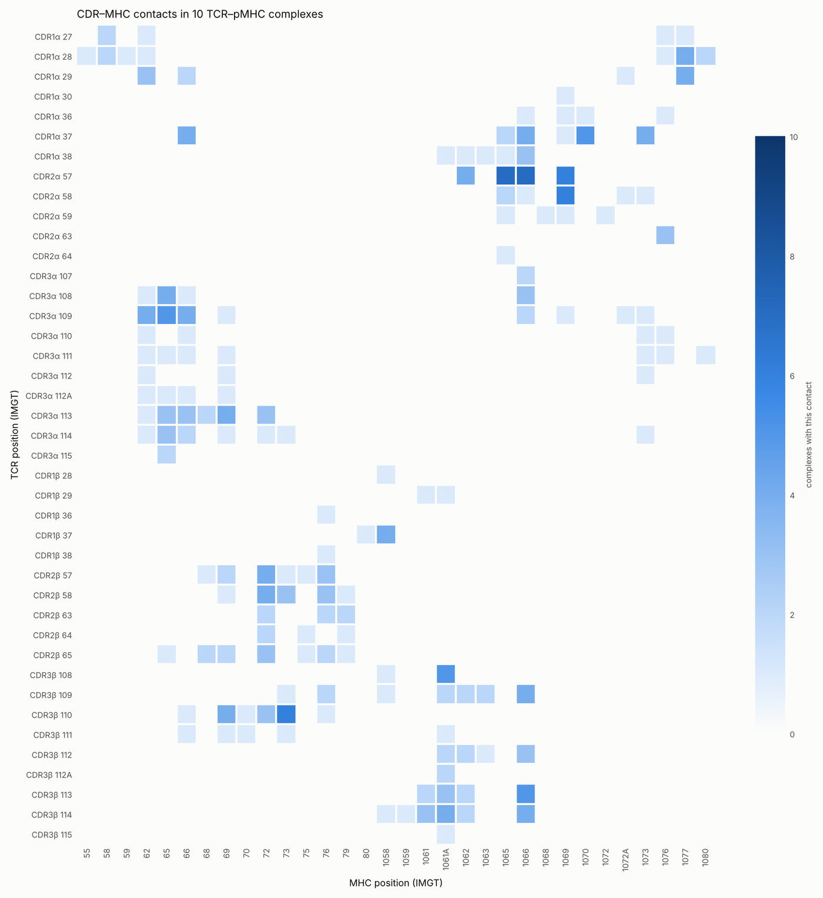
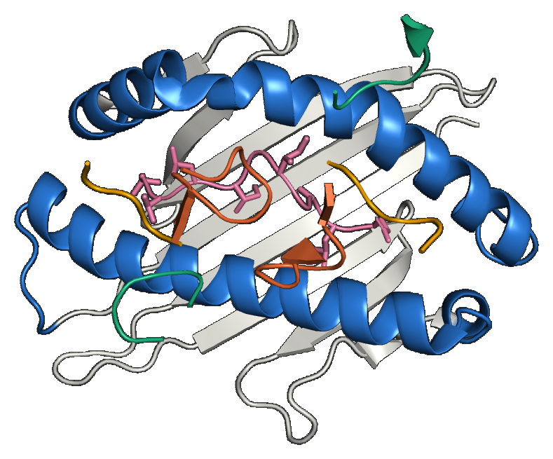

# Examples

Small scripts that show what IMGT numbering buys you: once every structure is numbered the
same way, a position means the same place in every complex, whatever the species, allele or
author numbering.

Get some structures first, e.g. from the RCSB:

```bash
mkdir structures
for id in 1AO7 1MI5 3QDG 1OGA 5BRZ 2VLJ 3GSN 4FTV 3HG1 2CKB; do
  curl -sf -o structures/$id.pdb https://files.rcsb.org/download/$id.pdb
done
```

| script | what it shows |
|---|---|
| [`try_imm_tools.ipynb`](try_imm_tools.ipynb) | every tool step by step, with a 3D view; runs in Google Colab without installing ([open](https://colab.research.google.com/github/X-lab-3D/imm-tools/blob/main/examples/try_imm_tools.ipynb)) |
| [`batch.sh`](batch.sh) | standardise a folder (one complex, standard chains, IMGT numbering), one annotation table, a list of problems |
| [`cdr3_table.py`](cdr3_table.py) | CDR3 sequences with V / J genes and IMGT positions (Python API) |
| [`contact_map.py`](contact_map.py) | TCR–MHC contacts by IMGT position, pooled over many complexes |
| [`docking_rmsd.py`](docking_rmsd.py) | score docked models against the bound structure (L-RMSD, I-RMSD, fnat, DockQ) |
| [`pymol_regions.py`](pymol_regions.py) | PyMOL script colouring CDRs, groove helices and peptide; optional top view of the TCR footprint |

## Standardise a folder

```bash
bash batch.sh structures/ std/
```

```
10 structures in std/; 2 check warnings; 0 failed
```

`std/annotation.tsv` has one row per chain of every structure; `std/problems.tsv` lists the
`imm_check` rows that are not OK – here a chain break in the 1AO7 TCR β chain and a few MHC
residues of 1MI5 that the two MHC model sets number differently (worth a look, rarely wrong).

## CDR3 table

```bash
python cdr3_table.py std/*_imgt.pdb > cdr3.tsv
```

```
file           chain  type       v_gene       j_gene      cdr3            length  imgt_positions
3QDG_imgt      A      TCR_alpha  TRAV12-2*01  TRAJ23*01   AVNFGGGKLI      10      105,106,107,108,109,113,114,115,116,117
1MI5_imgt      A      TCR_alpha  TRAV26-2*01  TRAJ52*01   ILPLAGGTSYGKLT  14      105,106,107,108,109,110,111,112A,112,113,114,115,116,117
```

Loops of different length line up: IMGT adds positions symmetrically in the middle of the
loop (111A, 112A, …) and leaves gaps in short ones.

## Contact map

```bash
pip install matplotlib
python contact_map.py structures/*.pdb -o contacts      # contacts.tsv, contacts.png
```



Each cell is a TCR position × MHC position pair, coloured by the number of complexes in
which they touch (heavy atoms within 4.5 Å). The canonical diagonal docking shows up
directly: CDR2β on the α1 helix (MHC 65–76), CDR1α/CDR2α on the α2 helix (1058–1077), the
CDR3s over the middle.

## Docking models vs the bound structure

```bash
python docking_rmsd.py 2CKB.pdb model_1.pdb model_2.pdb
```

```
model         L_RMSD  I_RMSD  fnat  DockQ  tcr_residues  pmhc_residues  interface_residues
model_1.pdb   1.07    1.09    0.80  0.812  221           282            133
model_2.pdb   5.40    2.59    0.57  0.510  221           282            133
```

Both files are standardised first (first complex, IMGT numbering, standard chain IDs), so
residues are matched by chain and number; only residues present in both are used. The
example models are the unbound 2C TCR (1TCR) placed on its bound position in 2CKB
(model_1) and the same rotated by 20° (model_2), written with chains A–E and residues
numbered from 1. The values agree with the DockQ program run on the same standardised
files.

## PyMOL

```bash
python pymol_regions.py std/3QDG_imgt.pdb > 3qdg.pml
pymol std/3QDG_imgt.pdb 3qdg.pml

python pymol_regions.py -footprint std/3QDG_imgt.pdb > 3qdg_top.pml   # view from the TCR
```



Groove helices blue, peptide pink, CDR1 yellow, CDR2 green, CDR3 orange (of both TCR chains).
The script only uses IMGT numbers, so the same command colours any TCR–pMHC structure, of any
species, the same way.
